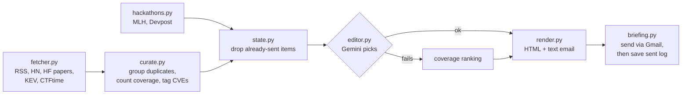

# Morning Briefing


A daily email newsletter covering AI/ML news, new research papers, security
news, New England hackathons, and upcoming CTFs. A GitHub Actions job builds and
sends it every morning, with nothing running on a personal machine.

The goal is a short list of what actually mattered that day, not an AI-written
summary of everything. Code does the fetching, de-duplicating, and ranking. A
language model (Gemini) is only allowed to choose from the stories it is given
and write one sentence about each, and the email still goes out if the model
is down.

## What's in the email

- **AI and machine learning**: news from OpenAI, Google DeepMind, Hugging Face,
  Google Research, Simon Willison, Import AI, Interconnects, Sebastian Raschka,
  MIT Technology Review, and popular Hacker News posts.
- **Research papers**: arXiv papers from Hugging Face Daily Papers, ranked by
  community upvotes, with links to the paper, the discussion, and the code.
- **Cybersecurity**: Krebs on Security, The Hacker News, Bleeping Computer,
  Dark Reading, and Hacker News. Any CVE a story mentions is checked against
  CISA's Known Exploited Vulnerabilities catalog and a public index of
  proof-of-concept exploit code, and tagged accordingly.
- **Project idea**: one multi-week AI/ML project based on the day's stories.
- **Hackathons**: in-person events in New England and large online AI or
  security events, from MLH and Devpost. Events at selected schools are marked
  as worth applying to.
- **CTFs**: competitions in the next three weeks, from CTFtime.

Each story shows which outlets covered it, and a footer reports any source that
failed or returned nothing.

## How it works



One run, in order:

1. **Fetch.** `fetcher.py` and `hackathons.py` call every source. Each source
   has its own error handling, so a failure costs that one source, and its
   outcome is recorded for the footer.
2. **Group duplicates.** `curate.py` groups articles about the same story,
   matching on shared URLs, shared CVE IDs, or TF-IDF similarity of the
   headline and summary. The number of distinct outlets in a group is its
   coverage, which is the ranking signal.
3. **Tag CVEs.** CVE IDs found in story text are looked up in the CISA KEV
   catalog and in PoC-in-GitHub.
4. **Skip what was already sent.** `state.py` keeps `state/sent.json`, a
   14-day log of sent links, CVEs, and hackathons.
5. **Pick.** `editor.py` sends the top candidates in each section to Gemini,
   which answers in JSON with story IDs, one sentence per pick, and a project
   idea. Code validates every field. If no model gives a usable answer, the
   top stories by coverage (or upvotes, for papers) are used instead.
6. **Render and send.** `render.py` builds the email, and `briefing.py` sends it
   over Gmail SMTP. The sent log is saved only after the send succeeds, and the
   workflow commits it back to the repository.

If the run crashes, a failure email is sent and the workflow opens a GitHub
issue.

## Design decisions

**The model chooses but never writes content that matters.** Gemini returns
story IDs. Titles, links, and tags always come from the fetched data, and IDs
that weren't in the candidate list are dropped. Its text is stripped of markup,
length-capped, and HTML-escaped. A prompt-injected headline can at worst
produce an odd sentence; it can't add a link, invent a story, or block the
email.

**Coverage as the ranking signal.** A story reported by four outlets is
probably more important than one reported by one. This needs no model, so it is
also the fallback ranking. Articles are grouped with TF-IDF cosine similarity:
each story becomes a vector of word weights, where words used by few of that
day's stories (such as a company name) count for more than common ones. The
merge threshold, 0.25, was chosen by scoring every pair of one day's 50
stories: real duplicates scored 0.26 to 0.87 and the closest unrelated pair
0.22. Groups are found with union-find, so if A matches B and B matches C, all
three merge. The gap is small and came from one day's data, so the threshold
is a starting point rather than a measured optimum.

**Fallbacks for each failure.** Gemini models are tried in order:
`gemini-4-hydrogen`, then `gemini-flash-latest`, then
`gemini-flash-lite-latest`, all on the free tier. Each attempt has a 90-second
timeout and no automatic retries.

**Silent failures are reported.** A source that throws an exception is easy to
notice. A source that quietly returns nothing, because a field was renamed, is
not. Sources that always have data (KEV, MLH, Devpost, CTFtime, Hacker News,
Hugging Face) report a zero as a possible failure in the email footer.

**Untrusted input is cleaned twice.** Everything fetched is untrusted. HTML
tags are stripped when data comes in, URLs are checked against an http/https
allowlist (which also catches tricks like `java\tscript:`), and every value is
HTML-escaped when the email is built. The email is built as HTML directly,
without converting Markdown, so there is no second markup language to escape.

**MLH is read from embedded JSON.** MLH has no API, but its events page embeds
the event list as JSON in a `<script>` tag. Reading that is more stable than
scraping visible HTML, and if the tag disappears the fetch fails with a clear
error, not by returning nothing.

**Sent log is written after sending.** If the state were saved first and the
send then failed, those stories would be skipped the next day and never seen.
Saving afterwards means a failed send costs a day of repeats instead.

## Reliability

From the GitHub Actions history of the previous version (July 8 to
November 17, 2026): 128 of 133 scheduled runs delivered an email. In the 91
runs whose logs are still retained, the Gemini call failed in 62 (mostly 503
"high demand" errors) and the raw-data fallback was sent. The 5 runs that
delivered nothing were all Gemini requests that hung until GitHub cancelled the
job at its 10-minute limit; a cancelled job also skipped the failure alert.
That led to the per-request timeout, the model fallback chain, and an alert
step that also fires on cancellation.

## Project layout

| File | Purpose |
|---|---|
| `briefing.py` | Entry point: runs the pipeline, sends the email, saves state |
| `fetcher.py` | News feeds, Hacker News, Hugging Face papers, CISA KEV, PoC lookup, CTFtime |
| `hackathons.py` | MLH and Devpost; New England, interest, and school filters |
| `curate.py` | Duplicate grouping, coverage ranking, CVE tagging |
| `state.py` | The sent log (`state/sent.json`) |
| `editor.py` | Gemini prompt, response validation, model fallback |
| `render.py` | HTML and plain-text email |
| `tests/` | 92 pytest tests; every outside call is faked |
| `.github/workflows/morning.yml` | Daily schedule at 12:00 UTC |
| `.github/workflows/tests.yml` | Runs the tests on every push and pull request |

## Running it

```bash
python -m venv .venv
.venv/bin/pip install -r requirements.txt pytest

# Build the email from live data and write preview.html / preview.txt.
# Sends nothing and records nothing. Works without any keys (no Gemini picks).
.venv/bin/python briefing.py --dry-run

.venv/bin/python -m pytest
```

Each module can also be run on its own to inspect its output, for example
`python curate.py` (today's stories grouped and ranked) or
`python hackathons.py`.

### GitHub Actions setup

Add these repository secrets under Settings, Secrets and variables, Actions:

| Secret | Value |
|---|---|
| `GEMINI_API_KEY` | A key from [Google AI Studio](https://aistudio.google.com/app/apikey) (free tier) |
| `EMAIL_SENDER` | The Gmail address that sends the email |
| `EMAIL_PASSWORD` | A Gmail [app password](https://myaccount.google.com/apppasswords) for that address (requires 2-Step Verification) |
| `EMAIL_RECIPIENT` | Where the email goes |

The workflow runs daily at 12:00 UTC (7 AM Eastern in winter, 8 AM in summer).
GitHub delays scheduled runs when it is busy, sometimes by hours, so news is
collected from a 36-hour window and the sent log prevents repeats. It can also
be started from the Actions tab.

## Configuration

| To change | Edit |
|---|---|
| News sources | `CYBER_FEEDS`, `AI_FEEDS` in `fetcher.py` |
| Hacker News sorting | `CYBER_KEYWORDS`, `AI_KEYWORDS` in `fetcher.py` |
| What the editor favors | `READER_INTERESTS` in `editor.py` |
| Stories per section | `MAX_PICKS` in `editor.py` |
| Gemini models | `MODELS` in `editor.py` |
| Paper vote threshold | `PAPER_MIN_UPVOTES` in `fetcher.py` |
| "Worth applying" schools | `GOOD_SCHOOLS` in `hackathons.py` |
| Duplicate threshold | `SIMILARITY_THRESHOLD` in `curate.py` |

## Known limitations

- The duplicate threshold was tuned on one day of stories. Whether two articles
  merge depends on what else was published that day.
- A follow-up article from a different outlet, with no shared link or CVE, can
  show up again on a later day.
- Hacker News stories are sorted into AI or security by keyword, so posts with
  neither kind of word in the title are skipped.
- The MLH reader depends on an undocumented part of their page.
